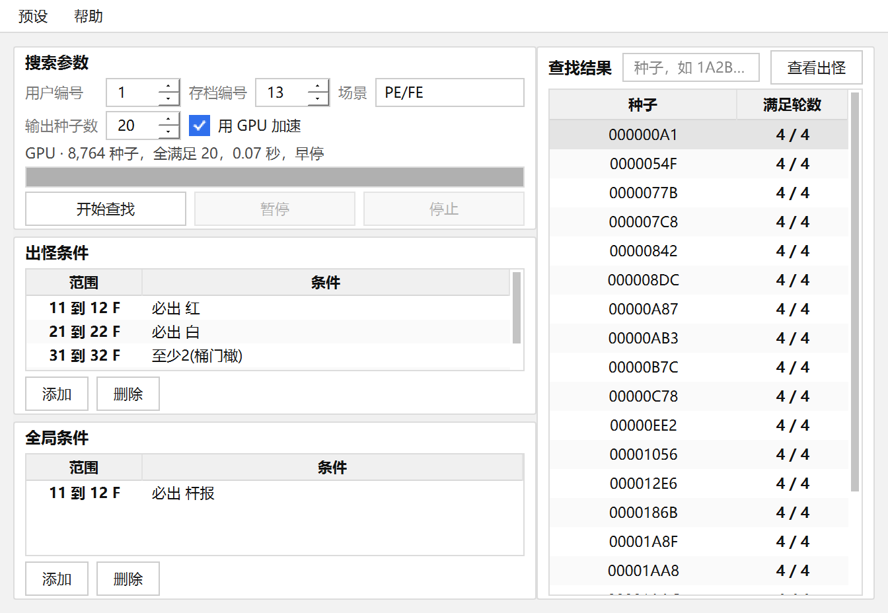

# seed-finder 2.0

《植物大战僵尸》无尽模式的种子查找器：把「第几 F 必须出什么僵尸」写成规则，反查满足要求的种子。

相比之下前面的版本，2.0 把「轮次区间」和「出怪条件」做成了可任意组合的规则，
底层出怪引擎完全重写（与原版逐位一致，快两个数量级），并且自带一套分层回归测试。



---

## 快速上手

1. 填 **用户编号**（游戏里的用户 ID）和 **存档编号**（游戏模式，通常 13），选 **场景**。
2. 在「**出怪条件**」里加一条或多条：每条自己指定一段 F 数范围 + 该段的出怪要求。
   不用先划总区间，扫描范围取所有条件覆盖范围的**并集**。
3. （可选）在「**全局条件**」里加硬性要求，任何一轮不满足就直接淘汰该种子。
4. 按 **开始查找**。

程序从 `00000000` 扫到 `FFFFFFFF`，不需要你设数量。扫描时显示进度、已检查数、命中数和预估剩余时间，
可以随时 **暂停 / 继续 / 停止**，暂停时长不计入预估。

结果按「满足轮数」从高到低排列。点一行看详情，双击把它抬到最前；
右上角的种子输入框可以直接填一个种子（16 进制）看它的逐轮出怪，不必先跑查找。

同一份源码有两套引擎，命中结果逐位一致：

| 引擎 | 25 轮全量扫描 | 说明 |
|---|---|---|
| CUDA（勾「用 GPU 加速」） | 约 2 秒 | 需要 NVIDIA 显卡；没编 CUDA 时勾选框自动置灰 |
| CPU（默认） | 约 25 分钟（24 核） | 无显卡也能跑 |

规模太小、显卡不可用或中途出错时引擎会自动退回 CPU，结果不变。

---

## 出怪条件 vs 全局条件

两者输入方式完全一样（一段区间 + 四组要求），**语义完全不同**：

| | 出怪条件 | 全局条件 |
|---|---|---|
| 作用 | **只排名**：满足的轮数越多排得越前 | **硬性淘汰**：有一轮不满足就没有结果 |
| 可以不加吗 | 至少要有一条 | 可以完全不加 |

四组要求同时生效，同一只僵尸只能属于其中一组：

| 要求 | 含义 |
|---|---|
| **必出** | 勾选的僵尸必须**全部**出现 |
| **禁出** | 勾选的僵尸**一个都不能**出现 |
| **至少出** | 勾选的这组里，实际出现的**种类数 ≥ N** |
| **至多出** | 勾选的这组里，实际出现的**种类数 ≤ N** |

条件表里没有「普僵」（每轮必出，设了没意义），也不会列出本场景不可能出现的僵尸。

**同一轮被多条条件覆盖时，要求取交集**：每一条都必须满足，这一轮才算满足。

---

## 几个实用规律（实测）

- 红眼最早只能在**第 6 轮**（F 11）出现；冰车、白眼最早**第 3 轮**（F 5）。区间划得太靠前必然无解。
- 路障和读报二选一，所以每轮至少有其中一个。
- 第 N 轮最多出现 `2 + N` 种僵尸（第 9 轮起封顶 11 种），下限是 `N + 1` 种。
- 条件越死越难满足。同时卡 3~4 轮的红眼，42 亿个种子里也未必有解——
  这时程序会提示最好的一档，据此逐步放宽。

---

## 详情表怎么读

黑白配色，用字形区分要求：

| 标记 | 含义 |
|---|---|
| `●`（粗） | 要求出现（必出 / 至少出） |
| `✕`（粗） | 要求不出现（禁出 / 至多出） |
| `○` | 出现了，但没对它设要求 |
| 空白 | 这一轮没出现 |
| 整行浅灰底 | 这一轮没满足条件 |

「已完成 F 数」沿用 1.2 版的叫法，轮次 = 该数字 / 2 + 1。

---

## 预设

**预设 → 保存当前参数…** 存下全部设置（含所有出怪条件和全局条件），**载入预设…** 恢复，
**删除预设…** 删掉不再需要的一套。

预设文件在 **exe 同目录的 `presets.json`**（绿色便携，拷 exe + json 即可换机器）；
目录不可写时自动退到 `%APPDATA%`。

---

## 构建

需要 Qt 5.12.9 (MSVC2017 64bit) 与 MSVC 生成工具（VS2017 及以上，VS2026 已实测通过）。

```bat
call "...\VC\Auxiliary\Build\vcvars64.bat"
set PATH=<Qt>\bin;%PATH%
qmake SeedFinder2.pro -spec win32-msvc "CONFIG+=release"
nmake release
```

静态单文件版（不依赖任何 Qt DLL，约 14 MB），额外加 `"CONFIG+=static"`。

### 可选：CUDA 后端

`_gpu/` 里是 CUDA 实现（源码入库，编译产物不入库）。工程用 `exists(_gpu/gpucuda.obj)` 探测：
有就用它并定义 `SF_WITH_CUDA`，没有就走 `src/core/gpuhook.cpp` 的空实现——
同一份源码、同一个 exe 自动退化成纯 CPU 版。

qmake 不认识 `.cu`，要另外调 nvcc：

```bat
cd _gpu
nvcc -Xcompiler "/MD" -D_ALLOW_COMPILER_AND_STL_VERSION_MISMATCH -arch=sm_120 -O3 -c gpucuda.cu -o gpucuda.obj
```

静态版把 `/MD` 换成 `/MT`、输出改成 `gpucuda_static.obj`（CRT 必须与主工程一致）。

---

## 测试

```bat
:: 自带的三条出厂自检
SeedFinder2.exe --selftest     :: 引擎与原版逐位对拍
SeedFinder2.exe --presettest   :: 预设存盘往返
SeedFinder2.exe --badtest      :: 条件校验的 11 组反例，都应被拦下
```

`tests/` 下还有一组独立的回归程序，其中 `suite` 是面向不同使用场景的分层测试：

| 层 | 覆盖内容 |
|---|---|
| L1 | 引擎自检（与原版分页实现逐位对拍） |
| L2 | 检索结果 vs 逐种子暴力枚举（含跨块 / 非去重 / 非零起点 / 含 level 0） |
| L3 | 条件校验的正例与反例、跨段矛盾、场景裁剪 |
| L4 | 边界：空扫描、种子空间末端、线程数 > 种子数、非法区间 |
| L5 | 交互：早停、取消、暂停、进度单调性 |
| L6 | 预设存读往返、损坏 JSON、旧格式、空条件带 |
| L7 | 纯函数：种子换算、掩码语义、文本输出 |

```bat
cd _build3\tests\suite
qmake ..\..\..\tests\suite.pro -spec win32-msvc "CONFIG+=release"
nmake release
release\suite.exe          :: 完整模式
release\suite.exe --quick  :: 跳过耗时用例
```

全套 163 项断言，正常约 2~4 秒，失败返回非零退出码，可直接接进 CI。

`tests/` 里其余程序是开发期的探针与对拍工具：
`xcheck`（与原版实现四段交叉验证）、`engine_test`（引擎回归）、
`diag*`（差异定位）、`probe*`（出怪结构统计）。

---

## 源码结构

```
/
├── SeedFinder2.pro          qmake 工程（唯一构建入口）
├── src/
│   ├── main.cpp             入口 + 命令行开关
│   ├── core/                引擎层（不依赖 Qt Widgets）
│   │   ├── seedengine.h/.cpp  出怪引擎：MT19937 复刻 / 规则表 / 多线程检索
│   │   ├── gpuhook.h/.cpp     GPU 后端抽象（未编 CUDA 时退化为空实现）
│   │   └── zombiedata.h       20 种僵尸、场景、允许表
│   ├── app/                 应用层（无窗口）
│   │   ├── searchworker.h/.cpp  后台线程包装
│   │   └── presetstore.h/.cpp   预设 JSON 读写
│   └── ui/                  界面层
├── tests/                   回归测试与开发期探针
├── _gpu/                    CUDA 后端（可选）
└── resources/               图标与样式资源
```

引擎要点：

- 出怪表 `computeRow(pos, scene, d1[10])` 一次算出 10 项累积选卡表，`rowBits(d1, level)` 取第 level 轮。
- 轮次换算：第 r 轮 → `level = (r-1)/2`；`RuleBand.beginFlag = 起始轮-1`，`endFlag = 终止轮`。
- 扫描的是**连续种子空间**，`r_val` 通过 `pos += INV` 递推，避免每个种子一次乘法。
- **相邻轮次共用同一张选卡表**（`INV * 101 ≡ 1 (mod 2^32)`）：
  `(种子 s, 第 lv 轮)` 与 `(种子 s+101, 第 lv-1 轮)` 的 `r_val` 相同。
  连续 N 个种子 × W 轮只需 `N + 101*(W-1)` 张表，而不是 `N*W` 张。
- GPU 侧把同一条恒等式推到底：一个线程建一张表，判定阶段直接从显存读，全程不回主机。

---

## 命令行开关（开发用）

```
--selftest                 引擎自检，OK 则退出码 0
--presettest               预设存盘往返自检
--badtest [n]              条件校验的 11 组反例（给 n 只跑第 n 组）
--shot out.png             启动后截图退出
--runshot out.png          用当前参数跑一次查找，完成后截图退出
--demo --runshot out.png   同上，但先装一套多条件演示参数
--span 3000000             只扫前 300 万个种子（配合截图/调试）
--lookup 1A2B3C4D          直接查看某个种子的逐轮出怪
--progress 40              把进度条拨到 40%
--dialog cond|band|detail|howto|about   各对话框单独开窗
--nogpu                    强制只用 CPU
```

---

## 致谢

- [Rottenham/seed-finder-qt](https://github.com/Rottenham/seed-finder-qt) — 原始实现与算法内核
- [Kndy666/zombie_calculator](https://github.com/Kndy666/zombie_calculator) — 出怪规则参考实现
